# Wireframes

`responsible: Rubens Zambelli`

## Allgemein

### Login

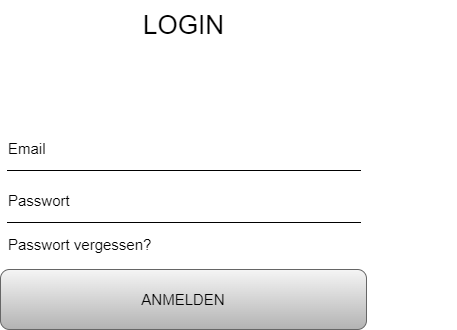

### Einstellungen Mobile

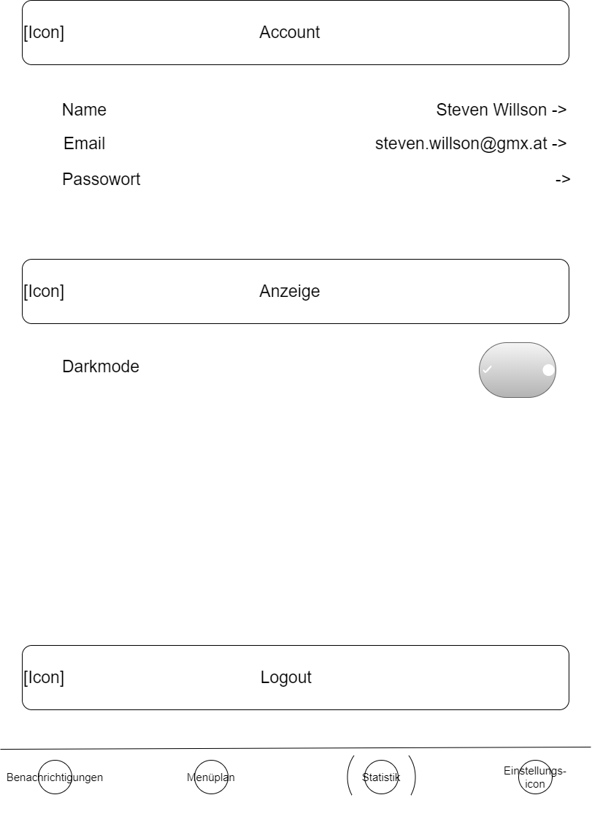

### Einstellungen PC

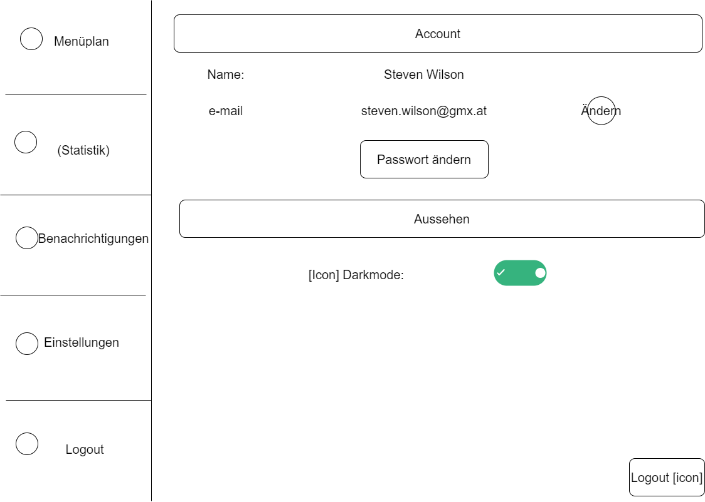

### Benachrichtigungen Mobile

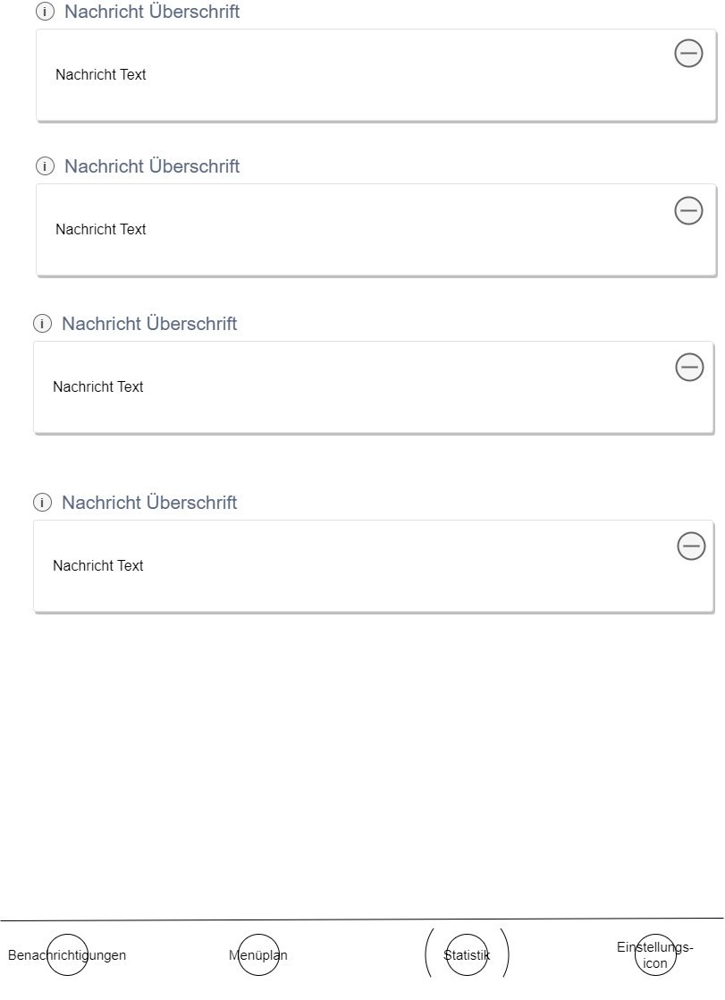

### Benachrichtigungen PC

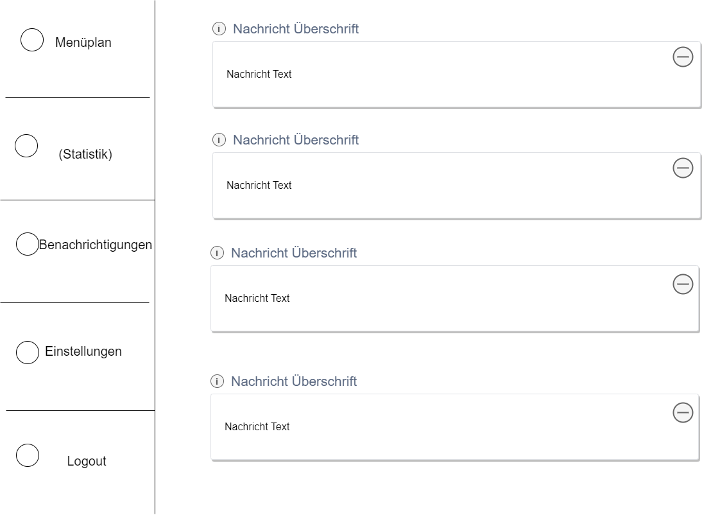

## Menüplan-Ansicht

`responsible: Thomas Fischer`

### Mobile

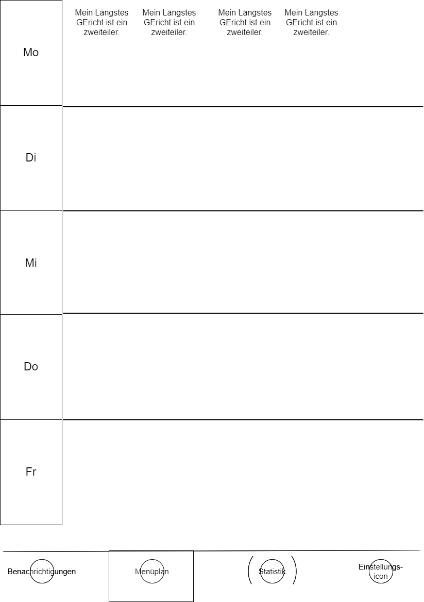

### PC

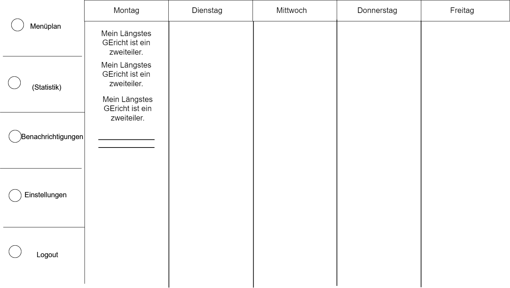

## Für Essen Anmelden

`responsible: Felix Reimüller`

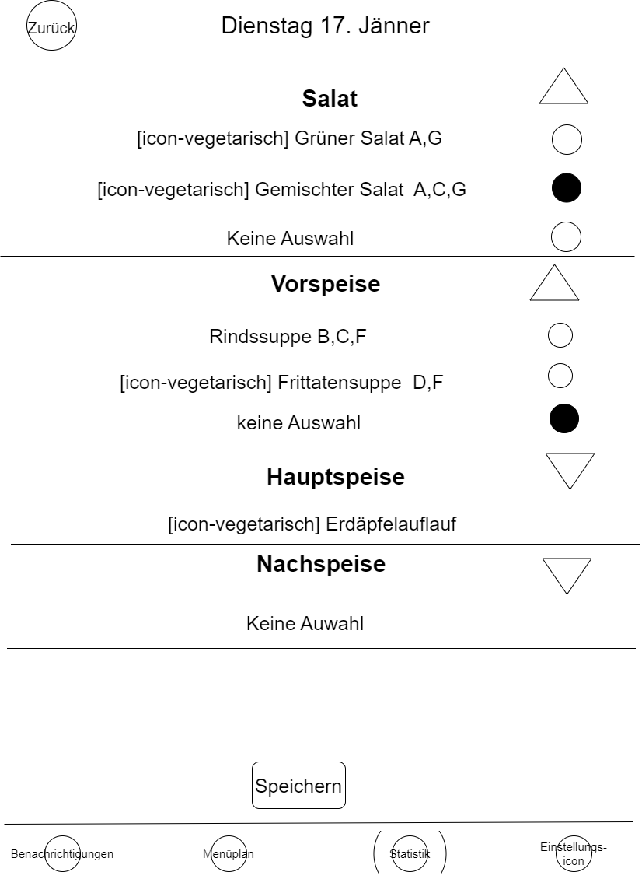

## Menüplan Erstellen

`responsible: Rubens Zambelli`

### Master-Ansicht

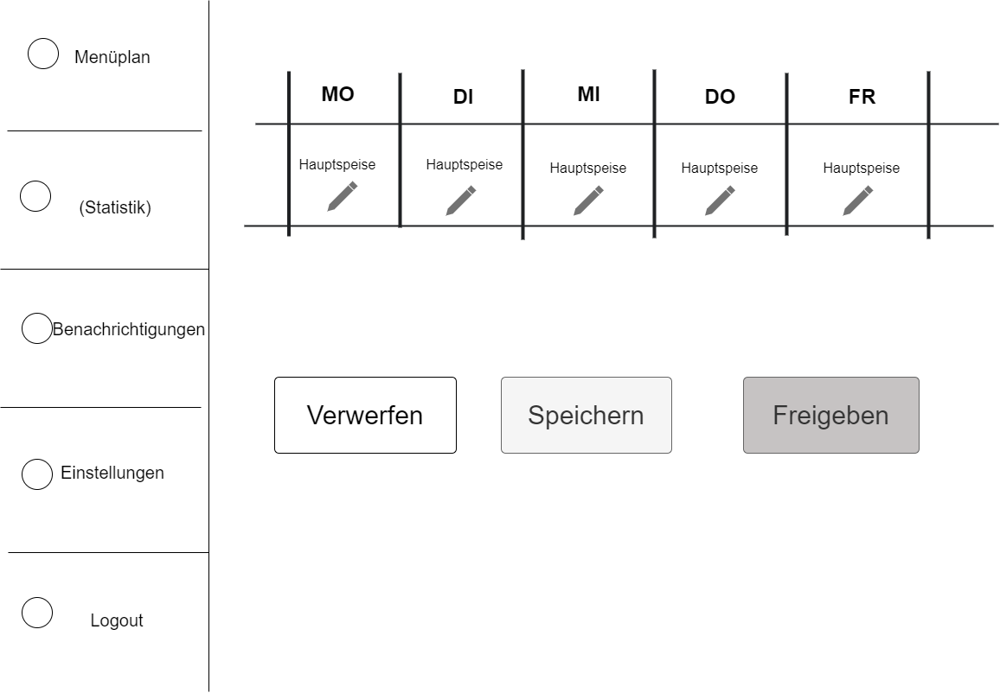

`responsible: Felix Reimüller`

### Tages-Ansicht

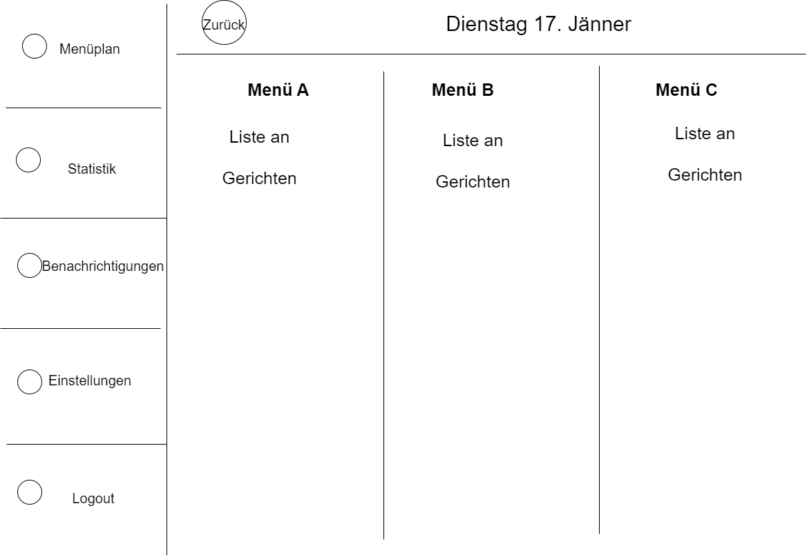

### Gericht-Erstellung

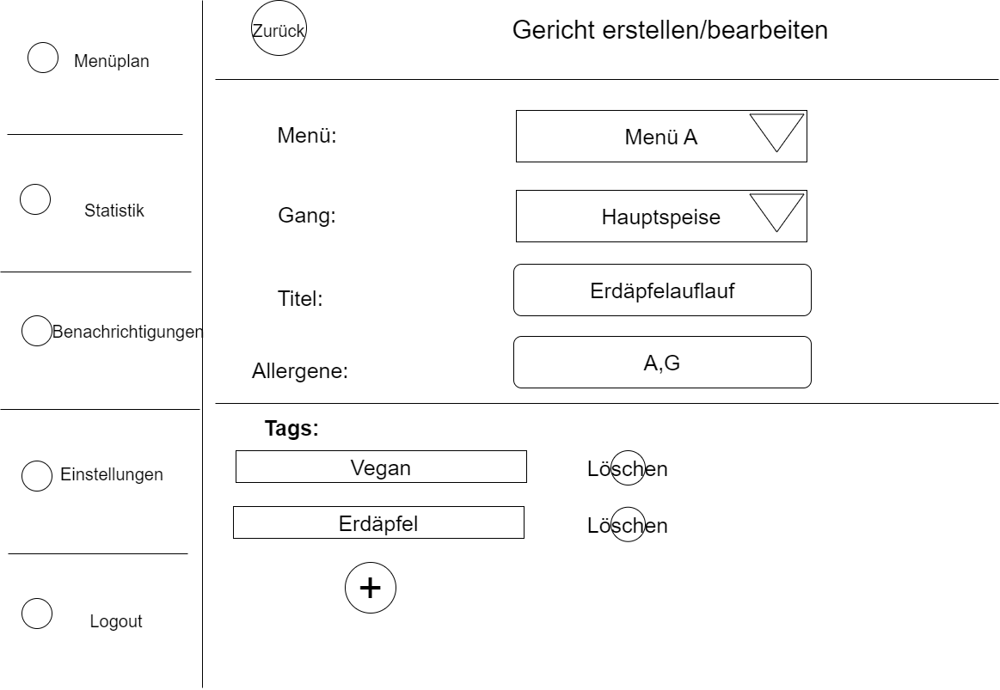

## Statistik 

`responsible: Rubens Zambelli`

### Mobile

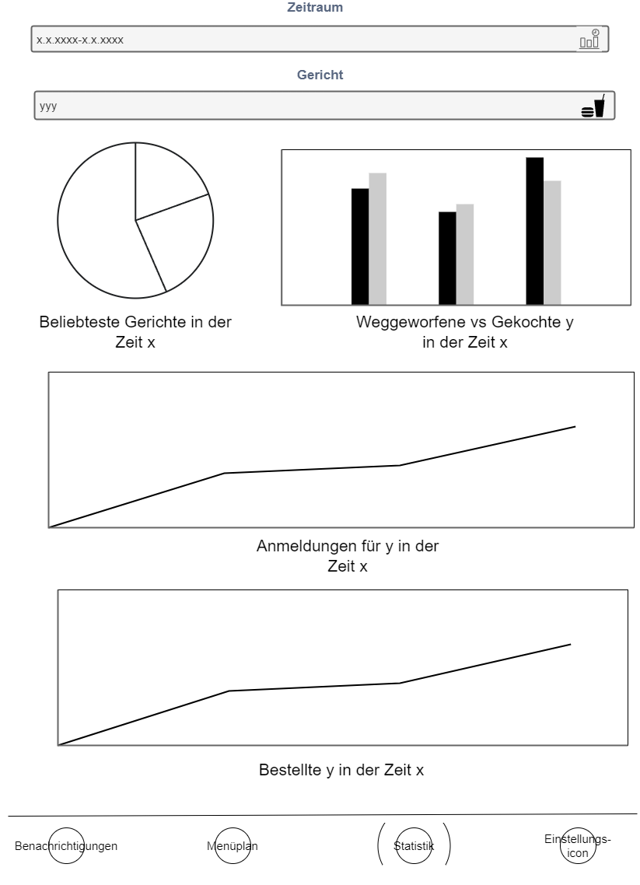

### PC

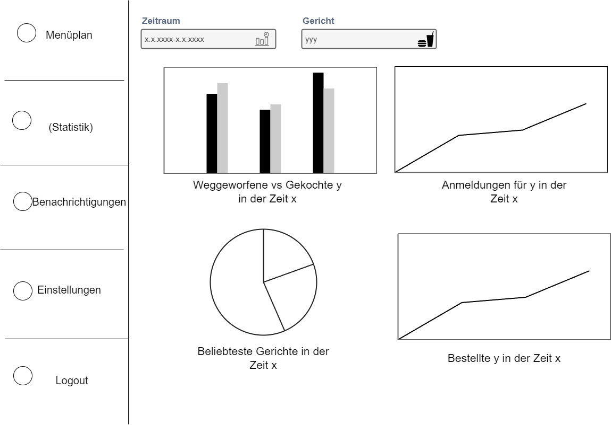